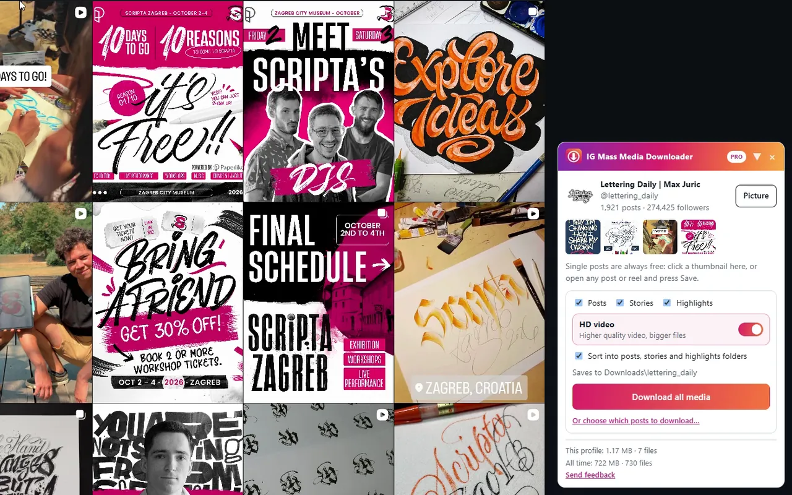
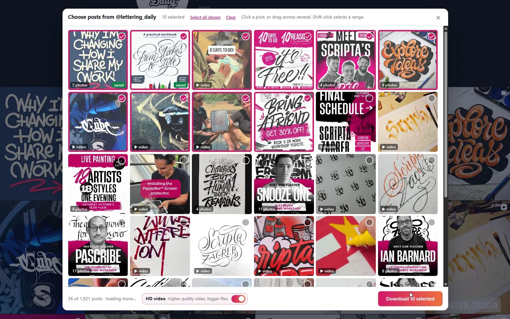
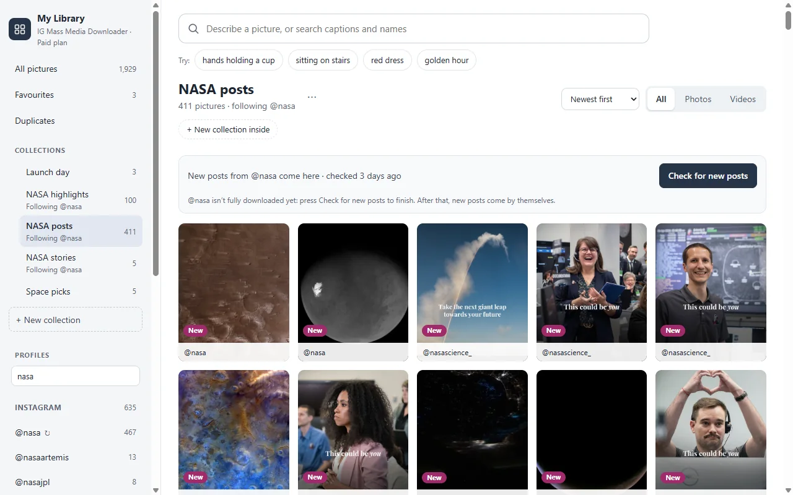

# IG Mass Media Downloader: an Instagram profile downloader for Chrome

A browser extension that saves a whole Instagram profile in one click: every post, reel, story and highlight, in the best quality Instagram has, into one tidy folder. For Chrome, Brave and Edge.

**[Add to Chrome](https://chromewebstore.google.com/detail/ig-mass-media-downloader/pkndnkmpggafjcjbecllfdkeeifdicid)** · [Website](https://novabyteworks.com/) · [Guides](https://novabyteworks.com/guides) · [Pricing](https://novabyteworks.com/pricing) · [Privacy](https://novabyteworks.com/privacy)

> **This repository is for bug reports, feature requests and release notes.** The extension is not open source, so its code is not here. It is free for three profiles and for every single post; unlimited profiles need a paid licence.

## What it saves

- **Posts**, with every slide of every carousel, photos at full size
- **Reels and videos in HD**, merged from the best video and audio streams without re-encoding
- **Stories and highlights**, each highlight in a folder of its own
- **Your saved posts**: all of them, one collection, or only the ones you choose
- **Exactly the posts you pick**: click posts in a grid, or drag across a row
- **Only what is new**: run it again later and it skips what you already have

## How to use it

1. Log in to Instagram as usual and open any profile. The panel appears in the corner.
2. Choose what to save: posts, stories, highlights, HD video, or pick exact posts from the grid.
3. Press **Download all media**. The files land in `Downloads\Instagram\<profile>`, sorted. Switch tabs or minimise the browser; it keeps going.

Watch it: [the 48-second demo](https://youtu.be/MQC6QfM87n4), [saved posts](https://youtu.be/xxUYCNacvn8), [My Library](https://youtu.be/bWIuUSrLmng).

## My Library

Everything you saved, in one gallery on your own computer: collections, favourites, tags, duplicates, two pictures side by side, and a timed slideshow for drawing practice. It can keep the profiles you choose up to date with a daily check. On paid plans it adds smart search (describe a picture, like "red dress" or "golden hour"), which runs on your computer, and a backup to your own Google Drive.

## Free and paid

| | Free | Paid |
|---|---|---|
| Whole profiles | Three | Unlimited |
| Single posts and reels | Always | Always |
| Your saved posts | The 20 most recent | All of them |
| My Library | Yes | Plus smart search and Google Drive backup |

No sign-up is needed for the free plan. Paid is a one-time lifetime licence or a monthly plan: see [pricing](https://novabyteworks.com/pricing).

## Questions

**Is it safe for my account?** The extension makes the same requests the Instagram website makes when you scroll, at the pace of a fast scroll, and backs off when Instagram asks it to. Automated access is against Instagram's terms, so use it with your own account and keep the volume reasonable.

**Can it download private profiles?** Only profiles your account can already see, the same as on the website.

**Does it need my password?** No. It uses the login already in your browser. Nothing you download, and none of your cookies, are sent to us.

**What does it send to you?** Your Instagram account id and username, the profiles you download, and counts of how each download went, to run the free plan and licences and to fix problems. The [privacy policy](https://novabyteworks.com/privacy) has the details.

**Where do the files go?** Your browser's Downloads folder, under `Instagram`, in a folder named after the profile, with posts, stories and highlights in their own subfolders.

## Help

- [Download all posts from an Instagram profile](https://novabyteworks.com/download-all-instagram-posts)
- [Download your saved posts](https://novabyteworks.com/download-instagram-saved-posts)
- [Download highlights](https://novabyteworks.com/download-instagram-highlights)
- [Back up an Instagram account](https://novabyteworks.com/backup-instagram-account)
- [All guides](https://novabyteworks.com/guides)

## Report a bug or ask for a feature

[Open an issue](https://github.com/novabyteworks/instagram-downloader/issues/new/choose). Please say which version you have (it is shown on `chrome://extensions`) and what the panel showed.

For licence keys and payments, write to support@novabyteworks.com instead. Never post a licence key here.

## Release notes

See [CHANGELOG.md](CHANGELOG.md). Updates arrive by themselves through the Chrome Web Store.

## Our other extensions

- [TT Mass Media Downloader](https://github.com/novabyteworks/tiktok-downloader): every video and photo post of a TikTok profile, without the watermark
- [Mass Media Downloader](https://github.com/novabyteworks/mass-media-downloader): Pinterest, Reddit, X, Bluesky, Tumblr, Threads, Facebook and VSCO in one extension

---

IG Mass Media Downloader is made by [NovaByteWorks](https://novabyteworks.com). It is not affiliated with, endorsed by, or connected to Instagram or Meta Platforms, Inc.
